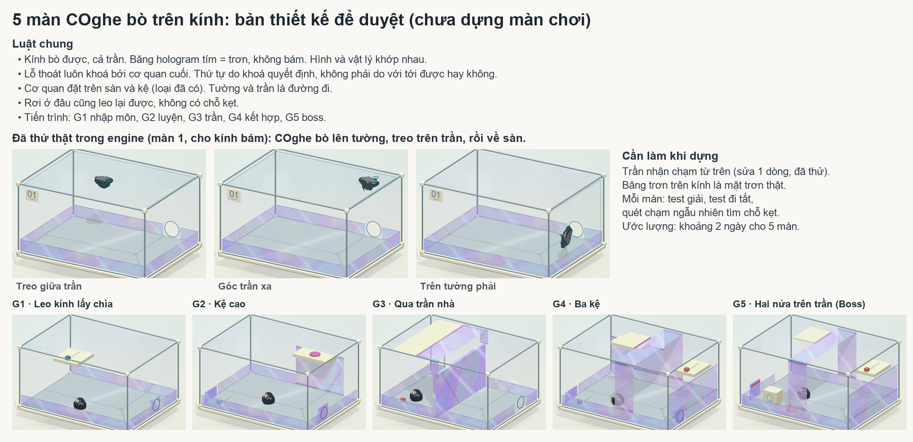
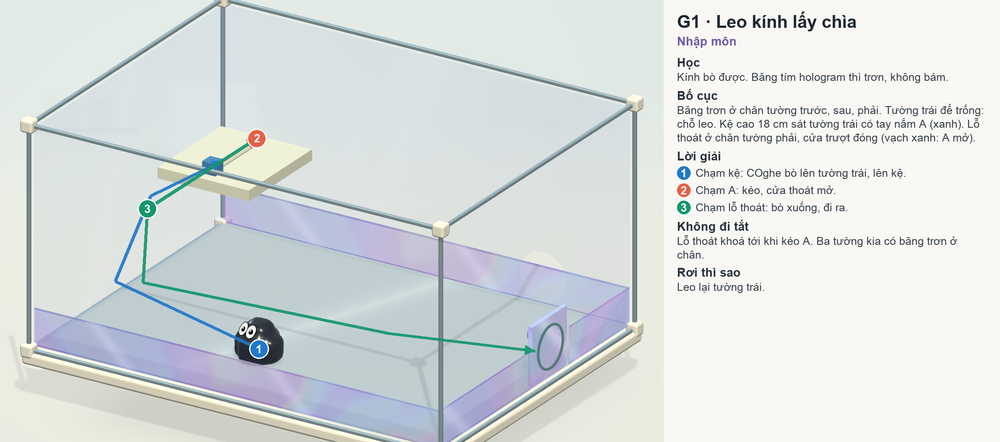
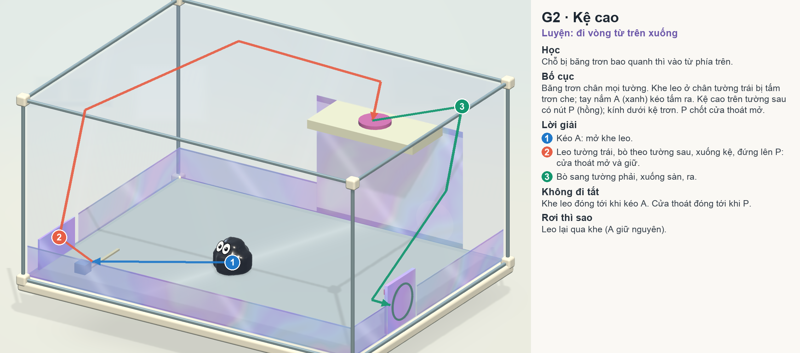
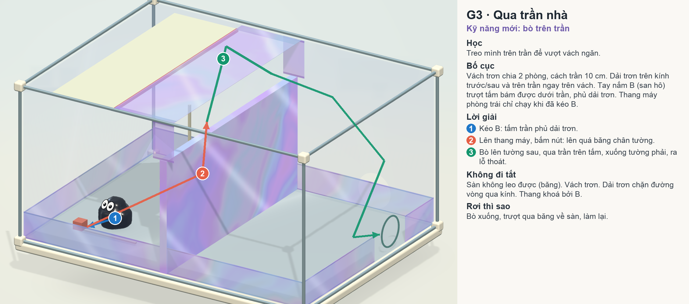
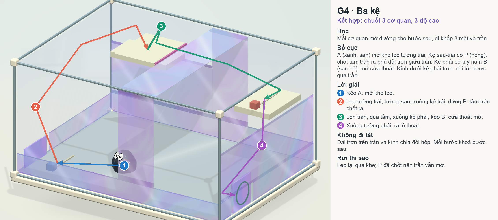
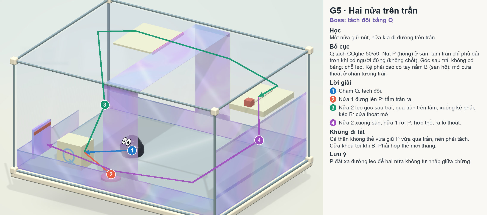
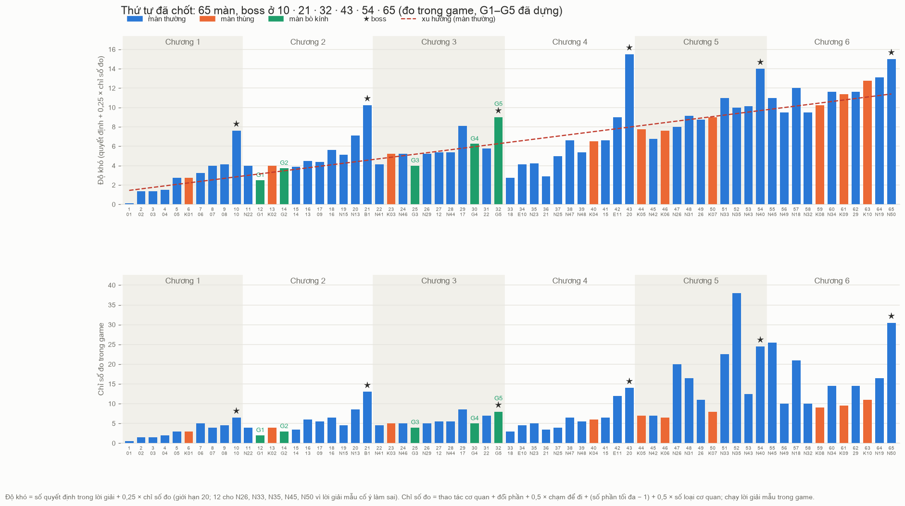

# COghe — 5 màn bò trên kính (G1–G5)

**Revision 15/10/2026:** thứ tự 65 màn và Boss G5 đã được điều chỉnh. Xem [nhịp học hiện hành](../Difficulty65/README.md) và [Boss 32 relay](../Difficulty65/BOSS32.md). Bảng điểm và lời giải G5 bên dưới là bản 12/10, không mô tả revision này.

Trạng thái: **Đã dựng** (12/10/2026), ở vị trí 12, 14, 25, 30, 32 của thứ tự 65 màn đã chốt. Hình dưới đây là blockout
lúc thiết kế (`GlassCrawlMocks`); chỗ bản dựng khác thiết kế ghi ở mục [Đã dựng](#đã-dựng-12102026).

Yêu cầu (Mrk, 12/10/2026): *"thiết kế thêm 5 màn mà COghe có thể bò lên kính, nhưng vẫn phải điều khiển các cơ quan
mới có thể đến được lỗ thoát. Có thể thiết kế theo nhiều hướng trong không gian 3D."*

## Luật chung cho 5 màn

- Kính bò được, kể cả trần. Băng hologram tím (băng dính trơn) là mặt trơn thật: không bám. Hình và vật lý khớp nhau.
- Lỗ thoát luôn bị khoá bởi cơ quan cuối. Thứ tự giải do khoá quyết định (RequiredRail, chốt), không do tầm với.
- Cơ quan đặt trên sàn và kệ (loại đã có: TapRail, nút nặng, chốt, thang máy, tấm trượt, Q). Tường và trần là đường đi.
  Chưa có tay nắm làm việc từ mặt đứng hoặc trần, nên không dùng.
- Rơi ở đâu cũng leo lại được; không có chỗ kẹt không lối ra.
- Hộp 40 cm, sàn 0,8 × 0,6 m. Băng chân tường cao 7 cm (COghe cao ~5 cm, với tối đa ~6 cm).
- Dải trơn dọc trên kính trước/sau và trên trần dùng để chặn đường vòng qua kính khi hộp chia đôi.

## Đã kiểm tra trong engine

`GlassCrawlProbe` (Explicit), màn 1, cho mọi tấm kính bám:

| Đích chạm | Kết quả |
| --- | --- |
| Giữa trần | tới (cách 2,6 cm), 28/32 hạt bám trần |
| Góc trần xa | tới (cách 3,2 cm), 29/32 hạt bám trần |
| Thấp trên tường phải | tới (cách 2,4 cm) |
| Cao trên tường sau | tới (cách 2,8 cm) khi trần không nhận chạm |
| Về sàn | tới |

- Màn Spatial ở chế độ `ViewOnly` không cho chạm kính từ phía ngoài, kể cả trần. Bản thử sửa 1 dòng trong
  `VenomCampaign.CanPick` (chưa commit; khi dựng phải kiểm lại các catalog cũ có trần bật `InterceptExterior`):
  `if(Definition.ViewOnly)return !face.ExteriorGlass||face.InterceptExterior||Vector3.Dot(ray.direction,face.Normal)<-.001f;`
  Không màn Spatial nào hiện bật cờ này. Không có dòng này, probe không tới được trần.
- Khi trần nhận chạm, chạm vào phần trên tường sau (nằm sau trần nhìn từ camera) sẽ rơi vào trần. Đặt đích chạm quan
  trọng ở chỗ không bị trần che, hoặc chỉ cho phần trần cần bò nhận chạm.
- Chưa có màn nào dùng lỗ thoát trên trần (`Outward` hướng lên); 5 thiết kế không dùng.

## G1 · Leo kính lấy chìa (nhập môn)

- Học: kính bò được; băng trơn thì không.
- Bố cục: băng chân tường trước, sau, phải. Tường trái để trống: chỗ leo. Kệ 18 cm sát tường trái, tay nắm A (xanh).
  Lỗ thoát chân tường phải, cửa trượt đóng (vạch xanh: A mở).
- Lời giải: chạm kệ (bò tường trái lên kệ) → kéo A (cửa mở) → chạm lỗ thoát.
- Đi tắt: lỗ thoát khoá tới khi kéo A. Phục hồi: rơi thì leo lại tường trái.

## G2 · Kệ cao (luyện: vào từ phía trên)

- Học: chỗ bị băng trơn bao quanh thì vào từ phía trên.
- Bố cục: băng chân mọi tường. Khe leo ở chân tường trái bị tấm trơn che; tay nắm A (xanh) kéo tấm ra. Kệ cao trên tường
  sau có nút P (hồng); kính dưới kệ trơn. P chốt cửa thoát mở (PlusLatch, retain).
- Lời giải: kéo A → leo tường trái, bò theo tường sau, xuống kệ, đứng P → bò sang tường phải, xuống sàn, ra.
- Đi tắt: khe leo đóng tới khi A; cửa thoát đóng tới khi P. Phục hồi: A giữ nguyên, leo lại qua khe.

## G3 · Qua trần nhà (kỹ năng mới: trần)

- Học: treo trên trần để vượt vách ngăn.
- Bố cục: vách trơn chia hai phòng, cách trần 10 cm. Dải trơn trên kính trước/sau và trên trần ngay trên vách. Tay nắm B
  (san hô) trượt tấm bám được dưới trần, phủ dải trơn. Thang máy phòng trái chỉ chạy khi đã kéo B (RequiredRail).
- Lời giải: kéo B → lên thang máy, bấm nút → bò tường sau lên trần, qua tấm, xuống tường phải, ra lỗ thoát.
- Sửa thao tác màn hiển thị 26 (22/10/2026): sau khi thang dừng trên, chạm thẳng lỗ thoát cũng dùng đường bám
  qua trần như chạm sàn phòng phải (`PreferGripForExit`). Nếu rơi về phòng trái, chạm nút trên thang trống để gọi
  xuống; lần đi lên tiếp theo vẫn phải lên khay và bấm nút. Tái sử dụng `EmptyTrayCallFromLowerLanding`, chỉ bật
  ở thang này, không đổi quy tắc bấm thang Boss 10. Xem [kiểm chứng](../../../Verification/COgheCeiling26/README.md).
- Đi tắt: sàn không leo được (băng); vách trơn; dải trơn chặn đường vòng qua kính; thang khoá bởi B.
- Rủi ro: COghe trượt ở mép dải trơn trên trần có thể rơi lên đỉnh vách. Dải trơn đặt hẳn về phía phòng trái để rơi
  luôn về phòng trái; kiểm bằng test đi tắt.

## G4 · Ba kệ (kết hợp)

- Học: chuỗi 3 cơ quan ở 3 độ cao, đi qua 3 mặt và trần.
- Bố cục: A (xanh, sàn) mở khe leo tường trái. Kệ sau-trái có P (hồng) chốt tấm trần phủ dải trơn giữa trần. Kệ phải có
  tay nắm B (san hô) mở cửa thoát. Kính dưới kệ phải trơn: chỉ tới kệ phải qua trần.
- Lời giải: A → leo, xuống kệ trái, đứng P → lên trần, qua tấm, xuống kệ phải, kéo B → xuống tường phải, ra.
- Đi tắt: dải trơn trên trần và kính chia đôi hộp; mỗi bước khoá bước sau. Phục hồi: P đã chốt, leo lại qua khe.

## G5 · Hai nửa trên trần (Boss)

- Học: tách đôi bằng Q; một nửa giữ nút, nửa kia đi đường trên trần.
- Bố cục: Q tách 50/50. Nút P (hồng) trên sàn: tấm trần chỉ phủ dải trơn khi có người đứng (không chốt). Góc sau-trái
  không có băng: chỗ leo. Kệ phải cao có tay nắm B (san hô) mở cửa thoát ở chân tường trái.
- Lời giải: chạm Q → nửa 1 đứng P → nửa 2 leo góc sau-trái, qua trần, xuống kệ phải, kéo B → nửa 2 xuống tường phải về
  sàn, nửa 1 rời P, hợp thể → ra.
- Đi tắt: cả thân không vừa giữ P vừa qua trần, nên phải tách; cửa khoá tới khi B; phải hợp thể mới thắng.
- Cần kiểm chứng: nửa thân bò trần và kéo B được; P đặt xa đường leo để hai nửa không tự hợp thể giữa chừng.

## Đã dựng (12/10/2026)

Mrk chốt thứ tự 65 màn (`REORDER_65`) và yêu cầu hoàn thiện, test kỹ. Builder: `Assets/_Game/Editor/COgheGlassCrawlLevels.cs`
(đăng ký cuối `PlusLevels()`, sinh bằng `GenerateChapterTwoLevels -coghe-plus-levels G1,G2,G3,G4,G5`).

**Engine**
- `VenomSurfacePatch.SlipRegions`: nhiều hình chữ nhật trơn trên một mặt kính. `Grip()` vẫn là phép thử bám duy nhất,
  nên chuyển động và tìm đường cùng thấy băng. Bước soft-edges vẽ băng đúng theo các vùng này (cắt quanh lỗ thoát).
- Không cần sửa `CanPick`: trần không nhận chạm từ ngoài. Chạm vào đích trên kệ/sàn bên kia, tìm đường tự đi qua
  trần. (Cho trần nhận chạm thì nó nuốt gần hết các chạm khác.)
- Cửa thoát (`ExitShutter`): tấm trơn mỏng trượt ngang dọc tường, không trượt lên, vì tấm nhô trên lỗ sẽ bắt chạm vào
  lỗ thoát. Mặt của nó không nhận chạm.
- Tuột khi đang đi xuống (`VenomCampaignMotion`, chỉ ở màn có kính bò được, tức có `SlipRegions`): tuột khi điểm kế
  tiếp của đường đi thấp hơn thân (chạm băng trơn, hoặc vắt giữa kệ và tường) là rơi về phía đích, nên lệnh được giữ và
  tìm đường lại khi chạm đất. Trước đây lệnh bị huỷ: COghe đứng yên dưới sàn, người chơi phải chạm lại. Đi lên mà tuột thì vẫn huỷ như cũ.
  Màn cũ không có `SlipRegions` nên không đổi.

**Khác thiết kế**
- G1: lỗ thoát ở z −0,10 (không phải giữa tường phải) để cửa trượt mở hẳn khỏi lỗ. Kệ bám được cả mép và mặt dưới
  (không phải kệ có cạnh trơn): COghe bò tường trái lên rồi vắt qua mép kệ. Với cạnh trơn, ở 30 khung hình/giây COghe
  không lên được kệ.
- G2: nút P đổi thành tay nắm B (nút nặng dạy ở chương 2, G2 nằm trước đó). Có thêm dải băng ở tường sau x 0,30–0,40,
  vì khe đó cho COghe leo tắt.
- G3: không có cửa trượt. Lỗ thoát nằm ở phòng phải, chỉ tới được qua trần, nên vách và tấm trần là khoá. B đặt xa
  tường, vì đứng trên tay nắm sát tường COghe leo được lên trần mà không cần thang.
- G4: tấm trần phủ hết chiều sâu hộp (tấm nhỏ thì không tới được). Cửa B trượt về sau 10 cm, lỗ thoát ở z −0,12.
- G5: lỗ thoát ở chân tường sau (cửa trượt sang phải). Q đặt trước nửa trái, COghe vào Q từ phía trước. Nút P đặt
  ngoài khay, xa đường leo.

**Kiểm tra** (`COgheGlassCrawlTests`, `COgheSpatialPlusTests`, `COgheSpatialPlusRecoveryTests`)
- Giải bằng lời giải mẫu: 5/5. Lang thang rồi về được: 5/5.
- Giải theo nhịp khung hình thật (`GlassCrawlG*SolveAtFrameRate` 60 fps, `GlassCrawlG*SolveAt30Fps`): 10/10. Test giải
  thường chỉ nhường khung hình mỗi 2 giây, nên không thấy được hai lỗi ở trên (tuột khi đi xuống, kệ cạnh trơn); clip
  quay ở 30 fps mới lộ ra.
- Không đi tắt: chạm cao trên kính sau và phải, mọi mặt kệ và lỗ thoát, không chạm cơ quan nào. Không màn nào thắng: 5/5.
- Băng 7 cm giữ được: chạm cao trên tường phải và tường sau từ sàn, hạt cao nhất ở −0,227 và −0,226, tức ngang đỉnh băng (−0,23): COghe không lên quá băng.
- Quét chạm ngẫu nhiên (`RandomTapsSweep`, 4 lượt mỗi màn ở vị trí 12, 14, 25, 30, 32): 0 lần ra ngoài hộp, 0 lần kẹt.
- Toàn bộ PlayMode trên trạng thái cuối: 837 đạt, 0 lỗi, 31 bỏ qua; EditMode 8/8. Build Mac sản phẩm (65 scene) thành công.
- Clip duyệt ở 30 fps, giải trọn cả 5 màn (`RecordReviewClips`, vị trí 12, 14, 25, 30, 32).

**Độ khó đo trong game** (`Tools/level_metrics/final65.py`, `MeasureLevelMetrics`)

| Màn | Vị trí | Chỉ số đo | Ước tính khi thiết kế | Độ khó D |
| --- | --- | --- | --- | --- |
| G1 | 12 | 2,0 | 2,5 | 2,50 |
| G2 | 14 | 3,0 | 4,0 | 3,75 |
| G3 | 25 | 4,0 | 5,0 | 4,00 |
| G4 | 30 | 5,0 | 5,5 | 6,25 |
| G5 (boss) | 32 | 8,0 | 10,5 | 9,00 |

Giới hạn: phần thưởng "Hiểu ra" lưu theo số chương (`bonus:N`). Save cũ của người thử đã nhận thưởng chương 2 cũ (sau
boss "20") sẽ thấy chương 2 mới (boss B1) là đã nhận. Không đổi phiên bản save, vì đổi sẽ xoá tiến trình.

Cả 5 màn dễ hơn ước tính một chút. G5 (boss 32, D 9,0) dễ hơn B1 (boss 21, D 10,25), nên đỉnh boss chương 3 thấp hơn
chương 2. Chờ Mrk chọn: giữ nguyên, hay làm G5 khó thêm một bước.
