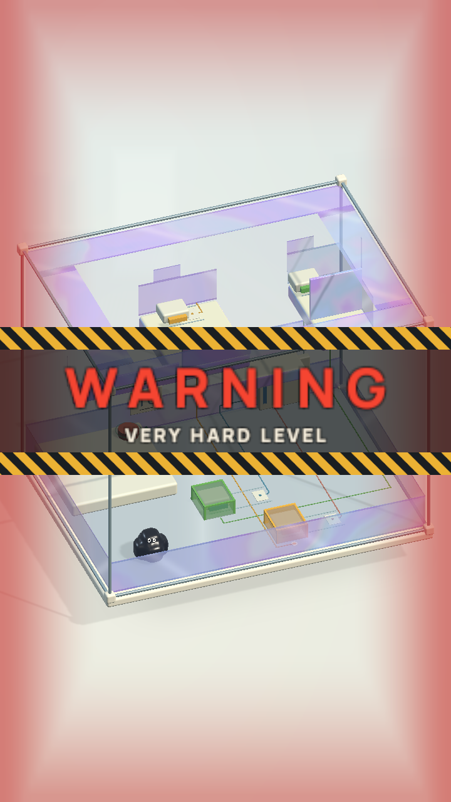
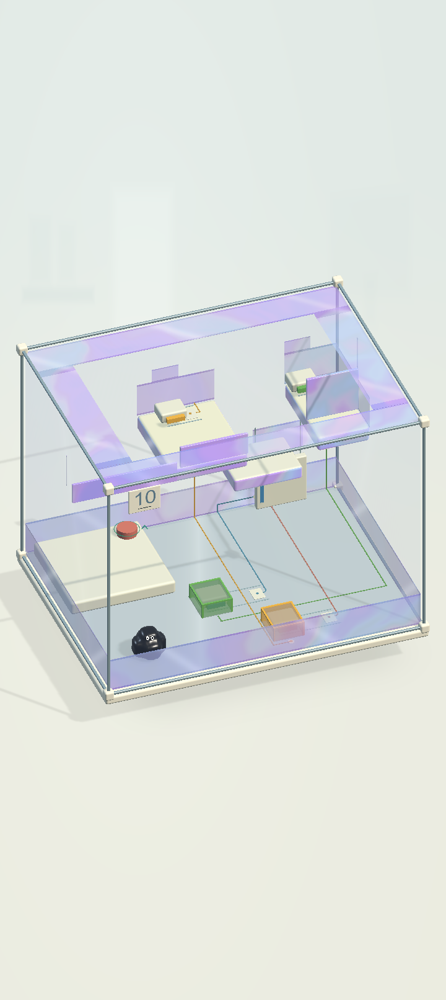

# Boss entry — static gameplay camera

16/10/2026. User request: remove the automatic camera rotation at the start of every Boss.

`COgheBossIntro` now runs only the existing 2.7 s warning banner at the authored gameplay view. Removed the mechanism tour, perspective dive, pullback/dolly zoom, camera ownership gate and skip-to-tour-end path. The ordinary camera rig owns the view throughout. Physics remains paused under the warning; its completion callback restores the Product HUD and playable state. Scene loading and resuming a Boss from Main Menu use the same warning component.

No scenes, mechanism configuration, colliders, level order, save IDs, manual orbit/zoom or victory framing were changed. Boss 10's puzzle is unchanged.

## Verification

- PlayMode `BossWarningsKeepTheGameplayCameraStill`: passed across all six Boss scenes at positions **10, 21, 32, 43, 54, 65**. Checks unchanged camera position, rotation, projection, size and clipping throughout the warning; stationary tissue; exactly one completion callback; pause released.
- PlayMode `AllFiftyScenesExposeProductControlsInsideTheSafeArea` (legacy name, now **65 scenes**): passed. Each Boss opens with the warning and an orthographic gameplay camera, then reaches Game. HUD safe area and Pause/Resume checked across all 65 scenes.
- Explicit `RenderBossIntro`: passed. Actual Unity renders of Boss 10 at **720×1280 and 720×1612**, during warning and after handover. Presentation fixture disables gameplay ticking; these are not full solve or performance tests.
- Source hash comparison after tests: **0 saved scenes changed**.
- Local evidence: `Artifacts/BossStaticCamera/tests.xml`, `render.xml`, logs and `Frames/`.
- macOS build succeeded: `Builds/SpatialLab/macOS/COghe.app`, build log `Artifacts/BossStaticCamera/build-mac.log`. Binary hash in `Artifacts/BossStaticCamera/result.json`. No additional scene or ProjectSettings changes from packaging. This change has not been installed on iPad/OPPO in this task. No new device FPS claim.

